# {heading(Тарифтік опциялар мысалдары)[id=tariff-examples]}

{include(/kz/_includes/_translated_by_ai_kz.md)}

## {heading(Тегін)[id=free-options]}

### {heading(Өзгертілмейтін integer типті опция)[id=integer_const]}

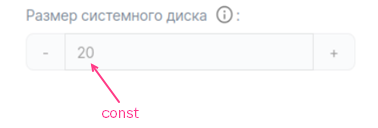{params[width=40%]}

```yaml
actions:
- create
- update

schema:
  description: Жүйелік дискінің өлшемі
  hint: ГБ есебімен
  type: integer
  const: 20
```

Мұнда:

- `actions` — `create` және `update` деген екі мәннен тұратын массив. Пайдаланушыға тарифтік опцияны қызметті қосқанда да, тарифтік жоспарды жаңартқанда да таңдауға мүмкіндік береді.
- `schema` — мәндердің тізбегі:

    - `description` — тарифтік опцияның атауы.
    - `hint` — тарифтік опцияның сипаттамасы (міндетті емес).
    - `type` — тарифтік опцияның түрі. `integer` деп көрсетіңіз.
    - `const` — тарифтік опцияның мәні.

### {heading(Тізімнен мән таңдау мүмкіндігі бар integer типті опция)[id=integer_list]}

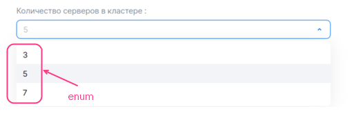{params[width=60%]}

```yaml
actions:
- create
- update

schema:
  description: Кластердегі серверлер саны
  type: integer
  enum: [3, 5, 7]
  default: 5
```

Мұнда:

- `actions` — `create` және `update` деген екі мәннен тұратын массив. Пайдаланушыға тарифтік опцияны қызметті қосқанда да, тарифтік жоспарды жаңартқанда да таңдауға мүмкіндік береді.
- `schema` — мәндердің тізбегі:

    - `description` — тарифтік опцияның атауы.
    - `hint` — тарифтік опцияның сипаттамасы (міндетті емес).
    - `type` — тарифтік опцияның түрі. `integer` деп көрсетіңіз.
    - `enum` — тарифтік опцияның мүмкін мәндері.
    - `default` — әдепкі мән.

### {heading(Өзгеру қадамы 1 болатын integer типті опция)[id=integer_step_1]}

Мәнді өзгертпей тұрып:


Мәнді 1 пунктке ұлғайтқаннан кейін:


```yaml
actions:
- create
- update

schema:
  description: Қатысушылар саны
  hint: Тапсырыс беруші компанияның тестілеу инфрақұрылымын пайдалана алатын және VK Testers тестілеушілерінен келген есептерді өңдей алатын қызметкерлерінің саны.
  type: integer
  default: 20
  minimum: 20
```

Мұнда:

- `actions` — `create` және `update` деген екі мәннен тұратын массив. Пайдаланушыға тарифтік опцияны қызметті қосқанда да, тарифтік жоспарды жаңартқанда да таңдауға мүмкіндік береді.
- `schema` — мәндердің тізбегі:

    - `description` — тарифтік опцияның атауы.
    - `hint` — тарифтік опцияның сипаттамасы (міндетті емес).
    - `type` — тарифтік опцияның түрі. `integer` деп көрсетіңіз.
    - `default` — әдепкі мән (міндетті емес).

    Параметр орнатылмаса, әдепкі мән `0`-ге тең болады.
    - `minimum` және `maximum` — тарифтік опцияның ең үлкен және ең кіші мәндері (міндетті емес).

### {heading(Пайдаланушы қадамымен өзгерту мүмкіндігі бар integer типті опция)[id=integer_users_step]}

```yaml
actions:
- create
- update

billing:
  base: 25
  cost: 0
  unit:
    size: 100

schema:
  description: Жүктеп алынатын жинақтардың көлемі
  hint: Платформаға тапсырыс берушінің қызметкерлеріне және VK Testers тестілеушілеріне тарату үшін қолданбалардың тестілеу жинақтарын жүктеуге болады. Сақтау орны неғұрлым үлкен болса, платформада соғұрлым көп өнім нұсқаларын сақтауға болады. Қолдау көрсетілетін платформалар: iOS, Android, Windows, MacOS, Linux.
  type: integer
  default: 0
```

Мұнда:

- `actions` — `create` және `update` деген екі мәннен тұратын массив. Пайдаланушыға тарифтік опцияны қызметті қосқанда да, тарифтік жоспарды жаңартқанда да таңдауға мүмкіндік береді.
- `billing` — мәндердің тізбегі:

    - `base` — стандартты мән.
    - `cost` — өзгеру қадамының құны. `0` деп көрсетіңіз.
    - `unit.size` — өзгеру қадамының өлшемі.
    - `unit.measurement` — тарифтік опцияның өлшем бірліктері (міндетті емес).

- `schema` — мәндердің тізбегі:

    - `description` — тарифтік опцияның атауы.
    - `hint` — тарифтік опцияның сипаттамасы (міндетті емес).
    - `type` — тарифтік опцияның түрі. `integer` деп көрсетіңіз.
    - `default` — әдепкі мән (міндетті емес). Опцияның стандартты мәніне қатысты орнатылады:

      - Әдепкі мәннің стандартты мәнге тең болуы үшін `default` параметрін көрсетпеңіз немесе `0` деп көрсетіңіз.
      - Әдепкі мәннің стандартты мән және енгізілген `n` мәні негізіндегі формула бойынша есептелуі үшін `n` бүтін мәнін көрсетіңіз:

         ```txt
         billing.base + n * billing.unit.size
         ```

    - `minimum` және `maximum` — тарифтік опцияның ең үлкен және ең кіші мәндері (міндетті емес). Әдепкі мән үшін жасалғандай орнатылады.

Төменде `default` параметрін таңдаудың тарифтік жоспарды конфигурациялау шеберіндегі опцияның көрінісіне әсері көрсетілген.

Пайдаланушы қадамымен өзгерту мүмкіндігі бар integer типті тегін тарифтік опция (billing.base = 25, schema.default = 0, billing.unit.size = 100):


Пайдаланушы қадамымен өзгерту мүмкіндігі бар integer типті тегін тарифтік опция (billing.base = 25, schema.default = 1, billing.unit.size = 100):


Пайдаланушы қадамымен өзгерту мүмкіндігі бар integer типті тегін тарифтік опция (billing.base = 25, schema.default = 2, billing.unit.size = 100):

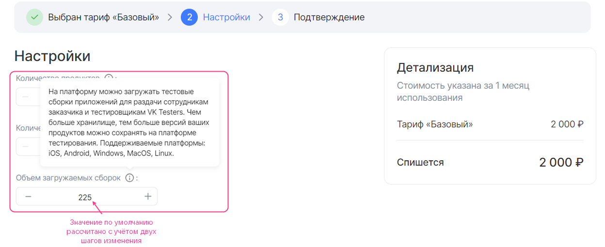

### {heading(string типті тегін тарифтік опция-константа)[id=string_const]}

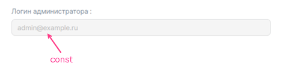{params[width=60%]}

```yaml
actions:
- create
- update

schema:
  description: Әкімші login-і
  type: string
  const: admin@example.ru
```

Мұнда:

- `actions` — `create` және `update` деген екі мәннен тұратын массив. Пайдаланушыға тарифтік опцияны қызметті қосқанда да, тарифтік жоспарды жаңартқанда да таңдауға мүмкіндік береді.
- `schema` — мәндердің тізбегі:

    - `description` — тарифтік опцияның атауы.
    - `hint` — тарифтік опцияның сипаттамасы (міндетті емес).
    - `type` — тарифтік опцияның түрі. `string` деп көрсетіңіз.
    - `const` — тарифтік опцияның мәні.

### {heading(Мәнді енгізу мүмкіндігі бар string типті тегін тарифтік опция)[id=string_input]}

{params[width=40%]}

```yaml
actions:
- create
- update

schema:
  description: Әкімші Email-і
  hint: SSL-сертификат шығаруға арналған Email
  type: string
```

Мұнда:

- `actions` — `create` және `update` деген екі мәннен тұратын массив. Пайдаланушыға тарифтік опцияны қызметті қосқанда да, тарифтік жоспарды жаңартқанда да таңдауға мүмкіндік береді.
- `schema` — мәндердің тізбегі:

    - `description` — тарифтік опцияның атауы.
    - `hint` — тарифтік опцияның сипаттамасы (міндетті емес).
    - `type` — тарифтік опцияның түрі. `string` деп көрсетіңіз.
    - `default` — әдепкі мән.
    - [Анықтамалықта](../../../manage-apps/ibservice_add/ibservice_configure/iboption#iboption_option_string) келтірілген қосымша параметрлер (міндетті емес).

### {heading(Тізімнен мән таңдау мүмкіндігі бар string типті тегін тарифтік опция)[id=string_list]}

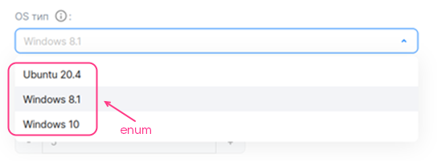{params[width=55%]}

```yaml
actions:
- create
- update

schema:
  description: OS түрі
  hint: Операциялық жүйе
  type: string
  enum: ["Ubuntu 20.4", "Windows 8.1", "Windows 10"]
  default: Windows 8.1
```

Мұнда:

- `actions` — `create` және `update` деген екі мәннен тұратын массив. Пайдаланушыға тарифтік опцияны қызметті қосқанда да, тарифтік жоспарды жаңартқанда да таңдауға мүмкіндік береді.
- `schema` — мәндердің тізбегі:

    - `description` — тарифтік опцияның атауы.
    - `hint` — тарифтік опцияның сипаттамасы (міндетті емес).
    - `type` — тарифтік опцияның түрі. `string` деп көрсетіңіз.
    - `enum` — тарифтік опцияның мүмкін мәндері.
    - `default` — әдепкі мән.

Төменде осы мысалдағы опцияның тарифтік жоспарды конфигурациялау шеберінде қалай көрсетілетіні көрсетілген.

### {heading(boolean типті тегін тарифтік опция-константа)[id=boolean_const]}

{params[width=40%]}

```yaml
actions:
- create
- update

schema:
  description: Premium қолдау
  hint: Тәулік бойы 24/7 техникалық қолдау
  type: boolean
  const: false
```

Мұнда:

- `actions` — `create` және `update` деген екі мәннен тұратын массив. Пайдаланушыға тарифтік опцияны қызметті қосқанда да, тарифтік жоспарды жаңартқанда да таңдауға мүмкіндік береді.
- `schema` — мәндердің тізбегі:

    - `description` — тарифтік опцияның атауы.
    - `hint` — тарифтік опцияның сипаттамасы (міндетті емес).
    - `type` — тарифтік опцияның түрі. `boolean` деп көрсетіңіз.
    - `const` — тарифтік опцияның мәні.

### {heading(boolean типті тегін тарифтік опция-ажыратқыш)[id=boolean_switch]}

{params[width=50%]}

```yaml
actions:
- create
- update

schema:
  description: Жаңартулар туралы хабарламалар
  hint: Қызметтің жаңа нұсқалары туралы хабарламаларды поштаға алу керектігі.
  type: boolean
  default: true
```

Мұнда:

- `actions` — `create` және `update` деген екі мәннен тұратын массив. Пайдаланушыға тарифтік опцияны қызметті қосқанда да, тарифтік жоспарды жаңартқанда да таңдауға мүмкіндік береді.
- `schema` — мәндердің тізбегі:

    - `description` — тарифтік опцияның атауы.
    - `hint` — тарифтік опцияның сипаттамасы (міндетті емес).
    - `type` — тарифтік опцияның түрі. `boolean` деп көрсетіңіз.
    - `default` — әдепкі мән (міндетті емес).

    `default` параметрі орнатылмаса, әдепкі мән `false` болады.

Төменде осы мысалдағы опцияның тарифтік жоспарды конфигурациялау шеберінде қалай көрсетілетіні көрсетілген.

## {heading(Алдын ала төлемді тарифтік опциялар)[id=prepaid]}

### {heading(Өзгеру қадамы бар алдын ала төлемді integer тарифтік опциясы)[id=prepaid-int]}

Мұнда:

- `actions` — `create` және `update` деген екі мәннен тұратын массив. Пайдаланушыға тарифтік опцияны қызметті қосқанда да, тарифтік жоспарды жаңартқанда да таңдауға мүмкіндік береді.
- `billing` — мәндердің тізбегі:

    - `base` — стандартты мән. Стандартты мән тарифтік жоспардың құнына кіреді.
    - `cost` — өзгеру қадамының құны.
    - `unit.size` — өзгеру қадамының өлшемі.
    - `unit.measurement` — тарифтік опцияның өлшем бірліктері (міндетті емес).

    `billing` секциясын толтыру мысалы:

    ```yaml
    billing:
      base: 25
      cost: 150
      unit:
        size: 100
    ```

    Бұл мысалда стандартты мәннен тыс опцияның әр 100 бірлігінің құны 150 ақша бірлігі. Төменде пайдаланушы мәнді ұлғайтқан сайын бұл опцияның тарифтік жоспарды конфигурациялау шеберінде қалай көрсетілетіні көрсетілген.

    Өзгеру қадамы бар integer типті ақылы тарифтік опция (billing.base = 25, billing.cost = 150, billing.unit.size = 100):

    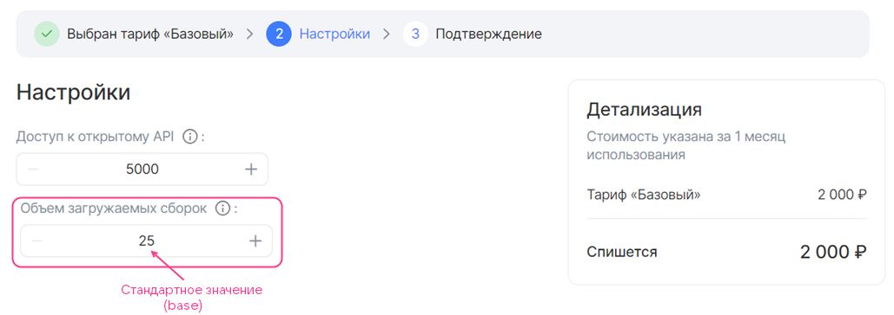

    Өзгеру қадамы бар integer типті ақылы тарифтік опция, мән 1 қадамға ұлғайтылған (billing.base = 25, billing.cost = 150, billing.unit.size = 100):

    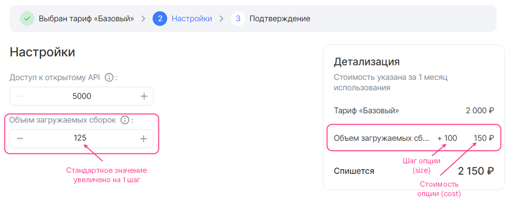

    Өзгеру қадамы бар integer типті ақылы тарифтік опция, мән 2 қадамға ұлғайтылған (billing.base = 25, billing.cost = 150, billing.unit.size = 100):

    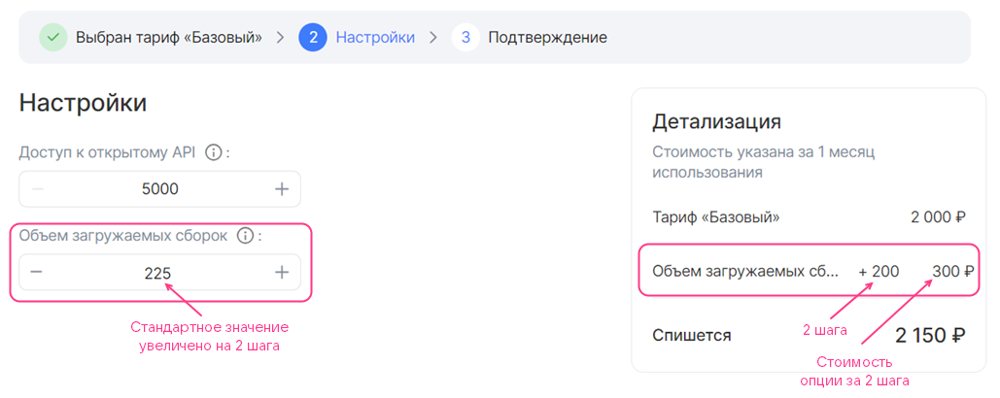

1. `schema` секциясын пайдаланушы қадамымен өзгерту мүмкіндігі бар тегін тарифтік опция үшін жасалғандай толтырыңыз.

    Егер тарифтік опцияның әдепкі мәні стандартты мәнге тең болмаса (`schema.default ≠ 0`), пайдаланушы тарифтік жоспарды конфигурациялау шеберіне өткенде, мұндай тарифтік опция үшін оның құны көрсетіледі (төмендегі суретті қараңыз). Пайдаланушы опцияның мәнін тарифтік жоспардың құнына кіретін стандартты мәнге дейін азайта алады.

    Өзгеру қадамы бар integer типті ақылы тарифтік опция (billing.base = 25, billing.cost = 150, billing.unit.size = 100, schema.default = 1):

    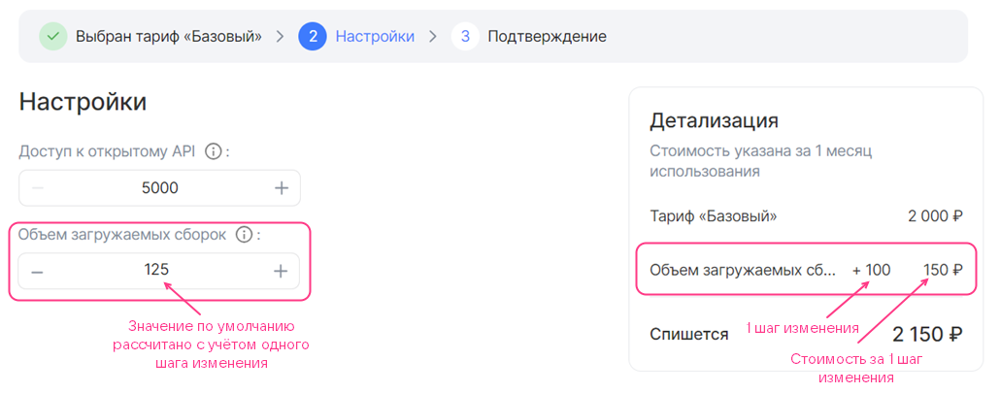

### {heading(Алдын ала төлемді boolean тарифтік опция-ажыратқыш)[id=prepaid_boolean]}

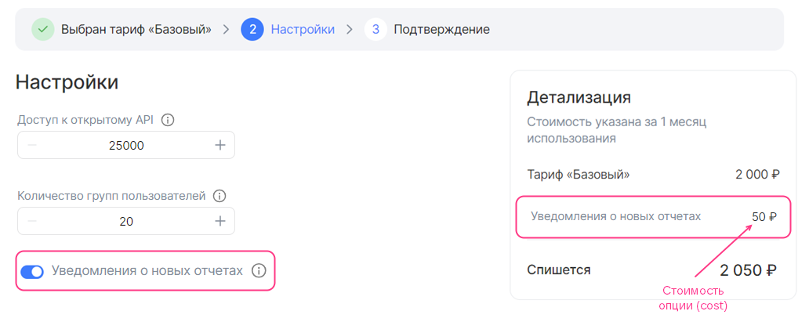{params[width=90%]}

```yaml
actions:
- create
- update

schema:
  description: Жаңа есептер туралы хабарламалар
  hint: Жаңа есептер туралы хабарламаларды поштаға алу керектігі
  type: boolean
  default: true

billing:
  cost: 50
```

Мұнда:

- `actions` — `create` және `update` деген екі мәннен тұратын массив. Пайдаланушыға тарифтік опцияны қызметті қосқанда да, тарифтік жоспарды жаңартқанда да таңдауға мүмкіндік береді.
- `schema` — мәндердің тізбегі:

    - `description` — тарифтік опцияның атауы.
    - `hint` — тарифтік опцияның сипаттамасы (міндетті емес).
    - `type` — тарифтік опцияның түрі. `boolean` деп көрсетіңіз.
    - `default` — әдепкі мән (міндетті емес).

    `default` параметрі орнатылмаса, әдепкі мән `false` болады.

- `billing` — integer типті бір `cost` мәнінен тұратын тізбек — ажыратқыш белсенді күйде тұрғандағы опцияның құны.

## {heading(integer немесе number типті кейінгі төлемді тарифтік опциясы)[id=postpaid_integer_or_number]}

{note:warn}

[Кейінгі төлемді тарифтік опциясына](/kz/tools-for-using-services/vendor-account/manage-apps/concepts/about#billing_push) арналған YAML-файлының атауы қызметіңіз Marketplace-ке жібереді (есептеу арқылы пайдаланылған ресурстар бойынша) метрикаларды жеткізетін API-сұраныстағы `param` мәніне сәйкес болуы тиіс.

{/note}

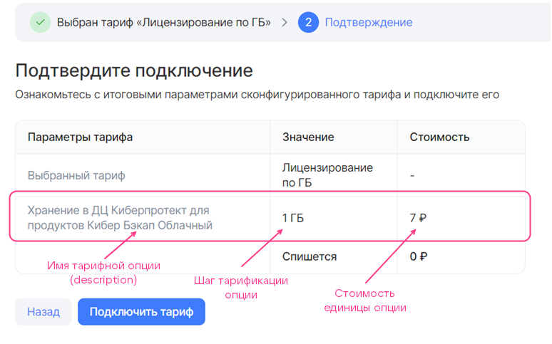{params[width=75%]}

```yaml
actions:
- resource_usages

billing:
  cost: 7
  unit:
    size: 1
    measurement: ГБ

schema:
  description: Бэкап Облачный өнімдері үшін Киберпротект ДҒ сақтауы
  type: number
```

Мұнда:

- `actions` — бір `resource_usages` мәнінен тұратын массив.
- `billing` — мәндердің тізбегі:

    - `cost` — тарифтік опцияның бір бірлігінің құны.
    - `unit.size` — тарифтеу қадамы. `1` деп көрсетіңіз.
    - `unit.measurement` — тарифтік опцияның өлшем бірліктері (міндетті емес).

- `schema` — мәндердің тізбегі:

    - `description` — тарифтік опцияның атауы.
    - `hint` — тарифтік опцияның сипаттамасы (міндетті емес).
    - `type` — тарифтік опцияның түрі. `integer` немесе `number` деп көрсетіңіз.

## {heading(datasource типті тарифтік опциялар)[id=datasource]}

### {heading(ВМ түрі)[id=datasource_vm]}

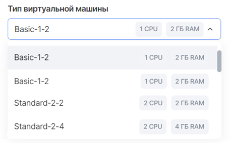{params[width=45%]}

```yaml
actions:
- create
- update

schema:
  description: Виртуалды машина түрі
  type: string
  datasource:
    type: flavor
```

Мұнда:

- `actions` — `create` және `update` деген екі мәннен тұратын массив. Пайдаланушыға тарифтік опцияны қызметті қосқанда да, тарифтік жоспарды жаңартқанда да таңдауға мүмкіндік береді.
- `schema` — мәндердің тізбегі:

    - `description` — тарифтік опцияның атауы.
    - `hint` — тарифтік опцияның сипаттамасы (міндетті емес).
    - `type` — тарифтік опцияның түрі. `string` деп көрсетіңіз.
    - `datasource.type` — бұлттық платформа нысанының түрі. `flavor` деп көрсетіңіз.
    - `datasource.filter` — фильтрлер (міндетті емес). Мүмкін фильтрлер [анықтамалықта](../tariff-options#iboption_datasource) келтірілген.

Төменде осы мысалдағы опцияның тарифтік жоспарды конфигурациялау шеберінде қалай көрсетілетіні көрсетілген.

### {heading(Қолжетімділік аймағы)[id=datasource_az]}

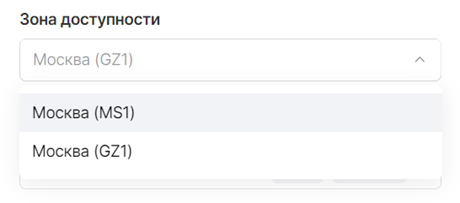{params[width=45%]}

```yaml
actions:
- create
- update

schema:
  description: Қолжетімділік аймағы
  type: string
  default: gz1
  datasource:
    type: az
```

Мұнда:

- `actions` — `create` және `update` деген екі мәннен тұратын массив. Пайдаланушыға тарифтік опцияны қызметті қосқанда да, тарифтік жоспарды жаңартқанда да таңдауға мүмкіндік береді.
- `schema` — мәндердің тізбегі:

    - `description` — тарифтік опцияның атауы.
    - `hint` — тарифтік опцияның сипаттамасы (міндетті емес).
    - `type` — тарифтік опцияның түрі. `string` деп көрсетіңіз.
    - `default` — әдепкі мән (міндетті емес). Мүмкін мәндер [анықтамалықта](../tariff-options#iboption_datasource) келтірілген.
    - `datasource.type` — бұлттық платформа нысанының түрі. `az` деп көрсетіңіз.

Төменде осы мысалдағы опцияның тарифтік жоспарды конфигурациялау шеберінде қалай көрсетілетіні көрсетілген.

### {heading(Субжелі)[id=datasource_subnet]}

```yaml
actions:
- create
- update

schema:
  description: Желі
  type: string
  datasource:
    type: subnet
```

Мұнда:

- `actions` — `create` және `update` деген екі мәннен тұратын массив. Пайдаланушыға тарифтік опцияны қызметті қосқанда да, тарифтік жоспарды жаңартқанда да таңдауға мүмкіндік береді.
- `schema` — мәндердің тізбегі:

    - `description` — тарифтік опцияның атауы.
    - `hint` — тарифтік опцияның сипаттамасы (міндетті емес).
    - `type` — тарифтік опцияның түрі. `string` деп көрсетіңіз.
    - `datasource.type` — бұлттық платформа нысанының түрі. `subnet` деп көрсетіңіз.

Төменде осы мысалдағы опцияның тарифтік жоспарды конфигурациялау шеберінде қалай көрсетілетіні көрсетілген.

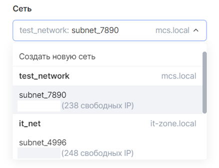{params[width=40%]}

### {heading(Желі)[id=datasource_net]}

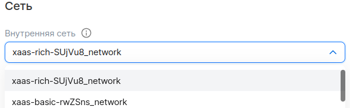{params[width=55%]}

```yaml
actions:
- create
- update

schema:
  description: Ішкі желі
  hint: Ішкі желі
  type: string
  datasource:
    type: network
    value_is: name
    filter:
      kind: private
      shared: false
```

Мұнда:

- `actions` — `create` және `update` деген екі мәннен тұратын массив. Пайдаланушыға тарифтік опцияны қызметті қосқанда да, тарифтік жоспарды жаңартқанда да таңдауға мүмкіндік береді.
- `schema` — мәндердің тізбегі:

    - `description` — тарифтік опцияның атауы.
    - `hint` — тарифтік опцияның сипаттамасы (міндетті емес).
    - `type` — тарифтік опцияның түрі. `string` деп көрсетіңіз.
    - `datasource.type` — бұлттық платформа нысанының түрі. `network` деп көрсетіңіз.
    - `datasource.value_is` — ақпарат шығару түрі. Мәндері қолжетімді:
    - `uuid` — желінің UUID-ін көрсету.
    - `name` — желінің атауын көрсету.
    - `datasource.filter` — фильтрлер (міндетті емес). Мүмкін фильтрлер [анықтамалықта](../tariff-options#iboption_datasource) келтірілген.

Төменде осы мысалдағы опцияның тарифтік жоспарды конфигурациялау шеберінде қалай көрсетілетіні көрсетілген.

### {heading(Диск)[id=disk]}

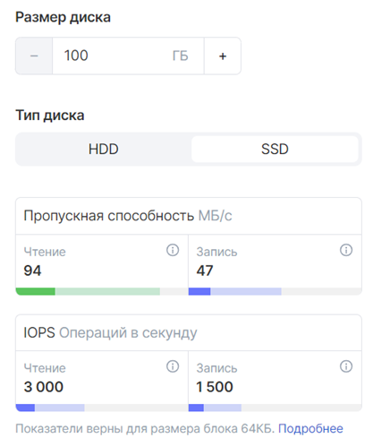{params[width=40%]}

Диск екі тарифтік опциямен (екі бөлек YAML-файлмен) сипатталады:

- Диск түрі — `datasource` түріндегі тарифтік опция арқылы.
- Диск өлшемі — өзгеру қадамы 1 болатын `integer` түріндегі тарифтік опция арқылы.

Дискті сипаттау үшін:

1. Бұлттық платформаның диск түрлері туралы деректерін алатын `datasource` түріндегі тарифтік опцияны `parameters/<ОПЦИЯ_АТЫ>.yaml` файлында сипаттаңыз:

    1. `actions` параметрін көрсетіңіз.
    1. `schema` бөлімінде мына параметрлерді орнатыңыз:

    - `description` — тарифтік опцияның аты.
    - `hint` — тарифтік опцияның сипаттамасы (міндетті емес).
    - `type` — тарифтік опцияның түрі. `string` мәнін көрсетіңіз.
    - `default` — әдепкі мән (міндетті емес). Мүмкін мәндер [анықтамалықта](../tariff-options#iboption_datasource) келтірілген.
    - `tag` — тег. Тег диск түрін сипаттайтын опцияны диск өлшемін сипаттайтын опциямен байланыстырады.
    - `datasource.type` — бұлттық платформа нысанының түрі. `volume_type` мәнін көрсетіңіз.
    - `datasource.filter` — сүзгілер (міндетті емес). Мүмкін сүзгілер [анықтамалықта](../tariff-options#iboption_datasource) келтірілген.

        Егер сүзгілер көрсетілмесе, бұлттық платформа қолдайтын барлық диск түрлері көрсетіледі.

    Диск түрі үшін `datasource` опциясын сипаттау мысалы, `YAML` форматы:

    ```yaml
    actions:
    - create
    - update

    schema:
      description: Тип диска
      type: string
      default: ceph-ssd
      tag: disk1
      datasource:
        type: volume_type
        filter:
          disk_class:
          enum: ["ssd", "hdd"]
    ```

1. Бөлек `parameters/<ОПЦИЯ_АТЫ>.yaml` файлында диск өлшемін өзгеру қадамы 1 болатын `integer` түріндегі тарифтік опция арқылы сипаттаңыз:

    1. `actions` параметрін көрсетіңіз.
    1. `schema` бөлімінде мына параметрлерді орнатыңыз:

    - `description` — тарифтік опцияның аты.
    - `hint` — тарифтік опцияның сипаттамасы (міндетті емес).
    - `type` — тарифтік опцияның түрі. `integer` мәнін көрсетіңіз.
    - `default` — әдепкі мән (міндетті емес).
    - `maximum` және `minimum` — ең үлкен және ең кіші мәндер (міндетті емес).
    - `tag` — тег. Мән диск түрін сипаттайтын файлдағыдай болуы тиіс.

    {note:info}

    Диск өлшемі ГБ-пен өлшенеді.

    {/note}

    Өзгеру қадамы 1 болатын `integer` түріндегі тарифтік опция арқылы диск өлшемін сипаттау мысалы, `YAML` форматы:

    ```yaml
    actions:
    - create
    - update

    schema:
      description: Размер диска
      type: integer
      default: 100
      minimum: 100
      tag: disk1
    ```

{note:warn}

Диск құны бұлттық платформаның тарифтерімен анықталады, сондықтан оны тарифтік опцияның сипаттамасында орнатуға болмайды.

{/note}