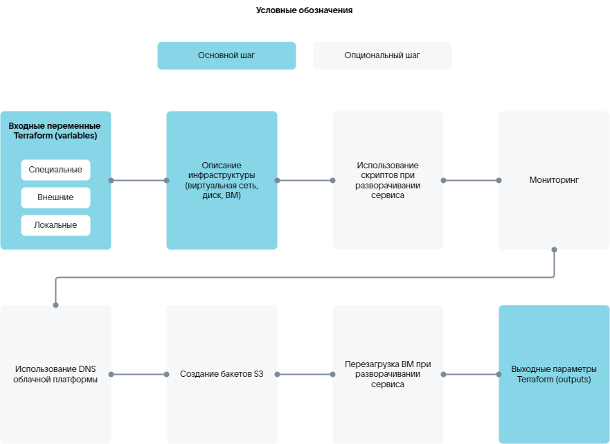

Terraform манифесті Marketplace-те image-based қосымшаның инстансын орналастыру үшін инфрақұрылым конфигурациясын сипаттайды. Сипаттама тілі — [HashiCorp Configuration Language (HCL)](https://developer.hashicorp.com/terraform/language/syntax/configuration).

Манифестте келесі элементтер қолданылады:

* `variables` — ресурстар конфигурациясына арналған кіріс айнымалылары.
* `resources` — инфрақұрылым нысандарын басқаруға мүмкіндік беретін ресурстар. Мысалы, ВМ жасау. Ресурстарды сипаттау кезінде `depends on` блогы арқылы тәуелділіктерді көрсетуге болады. Егер кемінде бір тәуелділік орындалмаса, ресурс жасалмайды.
* `data-sources` — [Terraform провайдерінен](#tf_providers) белгілі бір ақпарат алуға мүмкіндік беретін деректер көздері, мысалы, қолжетімді ВМ түрлерін алу немесе скрипттердің орындалу нәтижелерін алу.
* `outputs` — шығыс параметрлер, манифесттің орындалу нәтижелері.

## {heading(Terraform ресурс және деректер көздері провайдерлері)[id=tf_providers]}

{include(/kz/_includes/_translated_by_ai_kz.md)}

[cols="2,5,2", options="header"]
|===
|Аты
|Сипаттамасы
|Манифесттегі белгісі

|VK CS
|Сервистің инфрақұрылымын сипаттауға арналған ресурстар мен деректер көздерін қамтиды.

Ресурстар мен деректер көздерінің толық тізімі [провайдердің ресми құжаттамасында](https://github.com/vk-cs/terraform-provider-vkcs/tree/master/docs) келтірілген.

Ресурстарды жасауды сипаттайтын манифесттердің мысалдары Terraform-ді пайдалану бойынша [практикалық нұсқауларда](/kz/tools-for-using-services/terraform/how-to-guides) келтірілген
|`vkcs`

|VK CS Infra (iVK CS)
|Сервистің инстансының күйін бақылауға, скрипттерді іске қосуға және олардың нәтижелерін орналастыру процесінде пайдалануға мүмкіндік беретін сияқты VK CS провайдерінің мүмкіндіктерін кеңейтетін ресурстар мен деректер көздерін қамтиды. Скрипттер үшін Bash және Python тілдері қолданылады.

Ресурстар мен деректер көздері [VK CS Infra (iVK CS) провайдері бойынша анықтамалықта](../../../manage-apps/ivkcs) сипатталған
|`ivkcs`

|Null
|Провайдер ресурстары инфрақұрылым ресурстарымен тікелей байланыспайтын сыртқы процестерді немесе әрекеттерді іске қосу үшін қолданылады
|`null`

|Random
|Провайдер ресурстары сервистің инстансына кіру құпиясөздерін генерациялау үшін қолданылады. Толығырақ — [провайдердің ресми құжаттамасында](https://github.com/hashicorp/terraform-provider-random/tree/main/docs)
|`random`

|Time
|Провайдер ресурстары басқа ресурстар арасындағы уақыт бойынша өзара әрекеттесуді реттеу үшін қолданылады, мысалы, кідіріс немесе уақыт белгісін жасау үшін
|`time`
|===

## {heading(Terraform манифестінің компоненттері)[id=tf_manifest_parts]}

VK Cloud-та ВМ-де сервисті орналастыру қадамдарын сипаттайтын Terraform манифестінің схемасы:

{params[noBorder=true]}

Сервисті орналастырудың нақты қадамдары сіздің сервисіңізге қажет инфрақұрылымға және оның баптауларына байланысты.

Terraform манифестінің негізгі компоненттері:

1. [Ресурстар конфигурациясына арналған кіріс айнымалыларын сипаттау](../tfmanifest_variable), оның ішінде сервисті орналастыру идентификаторын қамтитын арнайы `instance_uuid` айнымалысы.
1. [Сервисті орналастыру инфрақұрылымын сипаттау](../tfmanifest_image).
1. [Шығыс параметрлерді сипаттау](../tfmanifest_output).

[iVK CS провайдерінің ресурстары](/kz/tools-for-using-services/vendor-account/manage-apps/ivkcs) арқылы сипатталатын қосымша компоненттер:

* [Скрипттерді пайдалану](../tfmanifest_script):

  * Сервисті орналастыру немесе қайта орнату процесінде скрипттерді орындау.
  * Скрипттердің орындалу нәтижелерін манифестің басқа ресурстары пайдалануы.
  * Скрипттердің орындалу нәтижелерін алу.

* Сервисті орналастыру немесе қайта орнату процесінде [мониторингті пайдалану](../tfmanifest_monitoring).
* [VK Cloud платформасының DNS-ін](/kz/tools-for-using-services/vendor-account/manage-apps/ivkcs/ivkcs_resources/ivkcs_dns) пайдалану.

   {note:warn}

   VK Cloud жеке кабинеті арқылы манифест орындалған кезде жасалған ресурстық DNS-жазбаларды басқару мүмкін болмайды, мысалы, оларды жою мүмкін болмайды.

   {/note}

* [VK Object Storage бакеттерін жасау](/kz/tools-for-using-services/vendor-account/manage-apps/ivkcs/ivkcs_resources/ivkcs_s3). Жасалған бакеттер VK Cloud жеке кабинетінде көрсетіледі.
* Сервисті орналастыру процесінде [ВМ-ді қайта жүктеу](/kz/tools-for-using-services/vendor-account/manage-apps/ivkcs/ivkcs_resources/ivkcs_compute_instance_reboot).

## {heading(Terraform манифестінің мысалы)[id=tf_manifest_example]}

Төменде келесілерді пайдалана отырып, бір ВМ-де Grafana сервисін орналастыруға арналған манифест келтірілген:

* сыртқы IP-адрестер;
* бұлтты платформаның DNS-і;
* адрестің қолжетімділігін мониторингілеу.

```hcl

# --------------------variables--------------------

# Арнайы айнымалылар

# Сервисті орналастыру идентификаторы
variable "instance_uuid" {
  type    = string
  default = "4a57a965-3c83-436c-80e2-428e421538cc"
}

variable "email" {
  type    = string
  default = "user@example.com"
}

# Сыртқы айнымалылар

# Сыртқы немесе ішкі IP-адресі бар орналасу
variable "grafana_placement" {
  type    = string
  default = "internal"
}

# Резервтік көшірмелеу
variable "backup_style" {
  type    = string
  default = "s3"
}

# Қолжетімділік аймағы
variable "ds-az" {
  type    = string
  default = "ME1"
}

# ВМ түрі
variable "ds-flavor" {
  type    = string
  default = "a493b27d-170d-48eb-a24b-99e9b325f988"
}

# Поджелі идентификаторы
variable "ds-subnet" {
  type    = string
  default = "cd4224ac-0527-4291-a8e0-afae0cee02ed"
}

# Root-диск түрі
variable "root_type" {
  type    = string
  default = "ceph-ssd"
}

# Root-диск өлшемі, ГБ
variable "root_size" {
  type    = number
  default = 10
}

# Деректерді сақтауға арналған диск түрі
variable "data_type" {
  type    = string
  default = "ceph-ssd"
}

# Деректерді сақтауға арналған диск өлшемі, ГБ
variable "data_size" {
  type    = number
  default = 1
}

# Сервис бейнесінің идентификаторы
variable "image_uuid" {
  type        = string
  default     = "8c7a6443-bb79-4f04-884a-14231f0ba6cb"
  description = "grafana image"
}

# Қауіпсіздік тобына арналған кіру порттары
variable "ports" {
  type    = list(number)
  default = [
    22, 80, 443
  ]
  description = "ports for secgroup rule. grafana [80, 443]"
}

locals {

# instance_uuid-дің қысқартылған нұсқасы
  short_name = substr(var.instance_uuid, 0, 8)

# Хост атын генерациялау
  hosts_name = "${local.short_name}-grafana"
}

# ---------------------data------------------------

# Виртуалды желінің деректерін алу
data "vkcs_networking_subnet" subnet {
  id = var.ds-subnet
}

# --------------------backup-----------------------

# S3 бакеттерін жасау
resource "ivkcs_s3" "s3_backup" {
  count = var.backup_style == "s3" ? 1 : 0
  name  = "${local.hosts_name}-backup"
}

# --------------------security group---------------

# Қауіпсіздік тобын жасау
resource "vkcs_networking_secgroup" "secgroup" {
  name = "${local.short_name}-grafana"
  sdn  = data.vkcs_networking_subnet.subnet.sdn
}

# Қауіпсіздік тобына арналған ережелер
resource "vkcs_networking_secgroup_rule" "rules" {
  count             = length(var.ports)

# Ережелерді қолдану бағытын анықтау — кіретін (ingress) немесе шығатын (egress) қосылымдар үшін
  direction         = "ingress"

# Кіру порттарының тізімі
  port_range_max    = element(var.ports, count.index)
  port_range_min    = element(var.ports, count.index)

# Кіру протоколы
  protocol          = "tcp"

# Қашықтағы желілік префикс
  remote_ip_prefix  = "0.0.0.0/0"

# Ережелері жасалған қауіпсіздік тобының идентификаторы
  security_group_id = vkcs_networking_secgroup.secgroup.id
  description       = "rule_tcp_${element(var.ports, count.index)}"
}

# --------------------network----------------------

# IP-адресті портқа байланыстыру
resource "vkcs_networking_port" "ports" {
  name               = "${local.short_name}-grafana"
  admin_state_up     = "true"
  network_id         = data.vkcs_networking_subnet.subnet.network_id
  sdn                = data.vkcs_networking_subnet.subnet.sdn
  security_group_ids = [
    vkcs_networking_secgroup.secgroup.id
  ]
  fixed_ip {
    subnet_id = var.ds-subnet
  }
}

# --------------------keypair----------------------

# Кілт жұбын жасау
resource "ivkcs_ssh_keypair" "keypair" {}

# --------------------------vm---------------------

# cloud-config конфигурациясын жасау. Хостта агентті инициализациялауға арналған деректерді алу
resource "ivkcs_user_data" "user_data" {

# Сервисті орналастыру идентификаторы
  uuid      = var.instance_uuid
  hosts     = [local.hosts_name]
  target_os = "almalinux9"

# SSH арқылы кіруге арналған кілттер
  ssh_authorized_keys = [
    ivkcs_ssh_keypair.keypair.public_key,
  ]
}

# ВМ жасау
resource "vkcs_compute_instance" "grafana" {
  name              = local.hosts_name
  flavor_id         = var.ds-flavor
  security_groups   = [vkcs_networking_secgroup.secgroup.name]
  availability_zone = var.ds-az
  metadata          = { "sid" : "xaas", "product" : "grafana" }

# Root-диск
  block_device {
    source_type      = "volume"
    destination_type = "volume"
    boot_index       = 0
    uuid             = vkcs_blockstorage_volume.boot.id
  }

# ВМ-ді баптау үшін cloud-config конфигурациясын қолдану. Агентті орнату
  user_data = ivkcs_user_data.user_data.user_data[0]

# IP-адресті ВМ-ге бекіту
  network {
    port = vkcs_networking_port.ports.id
  }

# Жою алдында ВМ-ді тоқтату әрекеті
  stop_before_destroy = true

# ВМ жасау тайм-ауты
  timeouts {
    create = "10m"
  }
}

# --------------------volume-----------------------

# Root-дискті жасау
resource "vkcs_blockstorage_volume" "boot" {
  name              = "${local.short_name}-grafana-boot"

# Метадеректер
  metadata          = { "sid" : "xaas", "product" : "grafana" }

# Сервис бейнесінің идентификаторы
  image_id          = var.image_uuid
  volume_type       = var.root_type
  size              = var.root_size
  availability_zone = var.ds-az
}

# Деректер дисін жасау
resource "vkcs_blockstorage_volume" "grafana_data" {
  name              = "${local.short_name}-grafana-data"

# Метадеректер
  metadata          = { "sid" : "xaas", "product" : "grafana" }
  size              = var.data_size
  availability_zone = var.ds-az
  volume_type       = var.data_type
}

# Деректер дисін ВМ-ге қосу
resource "vkcs_compute_volume_attach" "attached" {
  instance_id = vkcs_compute_instance.grafana.id
  volume_id   = vkcs_blockstorage_volume.grafana_data.id
}

# -----------------------external------------------

# Сыртқы IP-адрестер пулын алу
resource "vkcs_networking_floatingip" "fips" {
  count = var.grafana_placement == "external" ? 1 : 0
  pool  = data.vkcs_networking_subnet.subnet.sdn == "neutron" ? "ext-net" : "internet"
}

# ВМ-ге сыртқы IP-адресті тағайындау
resource "vkcs_compute_floatingip_associate" "fip" {
  count       = length(vkcs_networking_floatingip.fips)
  floating_ip = vkcs_networking_floatingip.fips[count.index].address
  instance_id = vkcs_compute_instance.grafana.id
}

# Бұлтты платформаның DNS-інде A-жазба жасау
resource "ivkcs_dns" "grafana" {
  count  = length(vkcs_networking_floatingip.fips)
  name   = "grafana-${local.short_name}"
  domain = "xaas.msk.vkcs.cloud"
  ip     = vkcs_networking_floatingip.fips[count.index].address
}

# --------------------agent-run--------------------
locals {
  grafana_domain   = var.grafana_placement == "external" ? "${ivkcs_dns.grafana[0].name}.${ivkcs_dns.grafana[0].domain}" : vkcs_compute_instance.grafana.access_ip_v4
  grafana_root_url = var.grafana_placement == "external" ? "https://${local.grafana_domain}" : "http://${local.grafana_domain}"

# ivkcs_agent_exec.start ресурсына арналған старттық скрипт
  start = <<-EOT
#!/bin/bash
ansible-playbook start.yml \
  --extra-vars "lego_enabled=${var.grafana_placement == "external" ? "true" : "false"}" \
  --extra-vars "lego_email=${var.email}" \
  --extra-vars "backup_enabled=${var.backup_style == "s3" ? "true" : "false"}" \
  --extra-vars "backup_access_token=${try(ivkcs_s3.s3_backup[0].access, "n/a")}" \
  --extra-vars "backup_secret_token=${try(ivkcs_s3.s3_backup[0].secret, "n/a")}" \
  --extra-vars "backup_bucket_name=${try(ivkcs_s3.s3_backup[0].name, "n/a")}_bucket" \
  --extra-vars "grafana_domain=${local.grafana_domain}" \
  --extra-vars "grafana_root_url=${local.grafana_root_url}"
EOT
}

resource "ivkcs_agent_exec" "start" {
  hosts = [local.hosts_name]
  name  = "start_grafana"
  uuid  = var.instance_uuid
  step {
    index   = 1
    type    = "bash"
    content = local.start
    options {
      timeout  = "20m"
      cwd      = "/opt/playbooks"
      attempts = 1
    }
  }

  depends_on = [
    vkcs_compute_instance.grafana,
    vkcs_compute_volume_attach.attached,
  ]
}

# --------------------health check-----------------

# ВМ мониторингілеу
resource "ivkcs_agent_check" "health" {
  hosts = [local.hosts_name]
  uuid  = var.instance_uuid

# Адрес бойынша мониторингілеу
  http_health {
    method     = "GET"
    protocol   = var.grafana_placement == "internal" ? "http" : "https"
    host       = local.grafana_domain
    path       = "/api/health"
    http_codes = [200]
    period     = "30s"
  }

  timeouts {
    create = "5m"
  }

  depends_on = [
    ivkcs_agent_exec.start,
  ]
}

# --------------------outputs----------------------

# ВМ-ге кіруге арналған жабық SSH-кілтін шығару
output "keypair" {
  value     = ivkcs_ssh_keypair.keypair.private_key

# Шығыс параметр сезімтал деректерді қамтиды
  sensitive = true
}

# Grafana URL-ін шығару
output "grafana_url" {
  value = local.grafana_root_url
}

# S3 бакетінің идентификаторын шығару
output "s3_backup" {
  value = try(ivkcs_s3.s3_backup[0].id, "n/a")
}
```