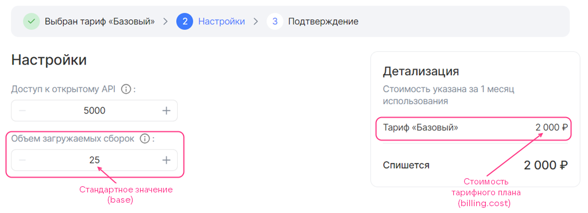
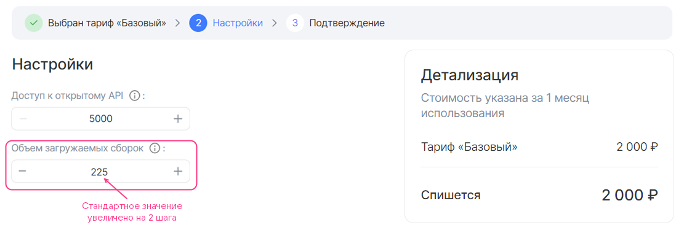
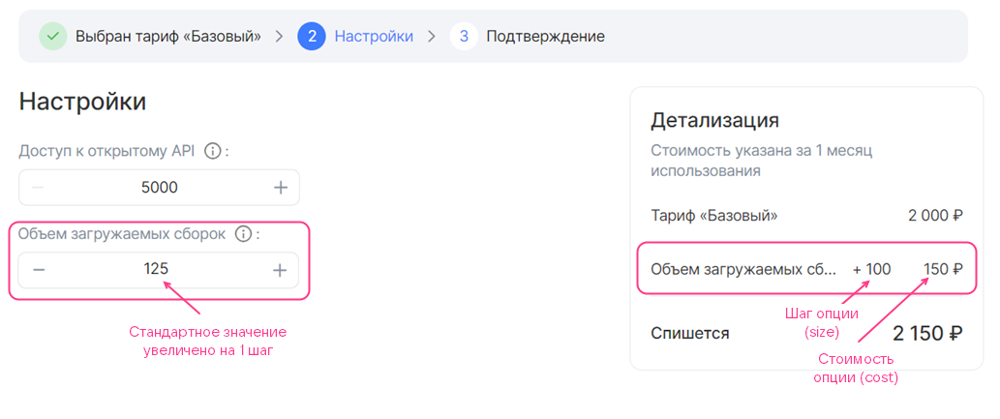
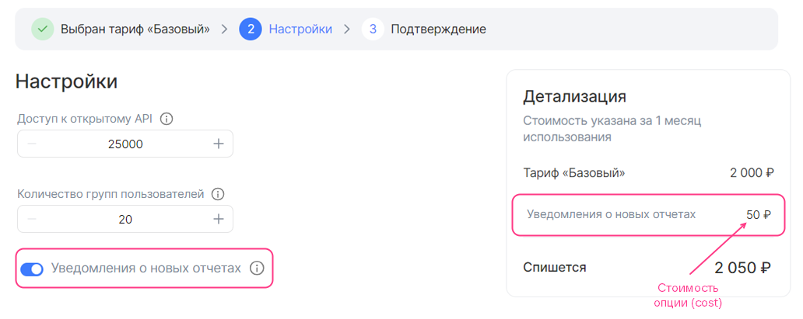
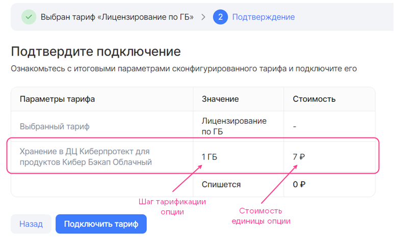

{include(/kz/_includes/_translated_by_ai_kz.md)}

`billing` секциясы [сервистің JSON конфигурация файлында](../../../instructions/manage-saas-apps/saas-add#service_config) келесі ақпаратты қамтиды:

* Тарифтік жоспардың құны.
* Тарифтеу үшін есепті кезеңнің ұзақтығы.
* Marketplace ресурс пайдалану туралы есептерді брокерден қаншалықты жиі сұрайтыны.
* Пайдаланылмаған бонустармен жұмыс істеу тәртібі.
* `integer` типті тарифтік опцияларды өзгерту қадамы.
* Жоспардың тарифтік опцияларының құны. Келесі ақылы тарифтік опциялар типтері қолдау көрсетіледі:

  * Сандық (`integer`, `number`). Алдын ала төлемді және кейін төлемді тарифтеу қолдау көрсетіледі.
  * Логикалық (`boolean`). Алдын ала төлемді тарифтеу қолдау көрсетіледі.

Тарифтеу типтері туралы толығырақ — [Тарифтеу](/kz/tools-for-using-services/vendor-account/manage-apps/concepts/about#xaas_billing) бөлімінде.

{note:warn}

Тарифтік жоспарда алдын ала төлемді және кейін төлемді опцияларды бір уақытта пайдалануға болмайды. Кейін төлемді тарифтік опциялар тек тегін тарифтік жоспарда болуы мүмкін.

{/note}

Қолданылатын тарифтеу типі тарифтік опциялар [schemas секциясында](../schemas-section) қай жерде сипатталғанына байланысты:

* Егер опциялар `service_instance.create` және `service_instance.update` секцияларында сипатталса, алдын ала төлемді тарифтеу қолданылады.
* Егер опциялар `service_instance.resource_usages` секциясында сипатталса, кейін төлемді тарифтеу қолданылады.

`billing` секциясының құрылымы келесідей:

```json
"billing": {
            "cost": <ҚҰНЫ>,
            "billing_cycle_flat": <ЕСЕПТІК_КЕЗЕҢ>,
            "billing_cycle_step": <ТЕКСЕРУЖИІЛІГІ>,
            "refundable": <ҚАЙТарылуға_ЖАТАДЫ>,
            "options": {
              "<ОПЦИЯ_АТЫ>": {
                <БИЛЛИНГ_ОПЦИЯЛАРЫ>
                },
              ...
              }
            }
```

Мұнда:

* `<ҚҰНЫ>` — ақылы тарифтік опцияларды есептемегенде, есептік кезең үшін жоспардың құны. Marketplace орналастырылған елдің валютасында көрсетіледі. Егер жоспар тегін болса, `0` мәні көрсетіледі. Тек алдын ала төлемді тарифтеу қолдау көрсетіледі.

* (Қосымша) `<ЕСЕПТІК_КЕЗЕҢ>` — тарифтеу үшін есептік кезеңнің ұзақтығы. Тек алдын ала төлемді тарифтік жоспар үшін орнатуға болады.

  Келесі форматта көрсетіледі: `<АЙ_САНЫ> mons <КҮН_САНЫ> days`. Мысалы, `1 mons 15 days` немесе `30 days`. Айдағы `mons` күндер саны күнтізбе бойынша есептеледі, сондықтан `1 mons 0 days` және `0 mons 31 days` кезеңдері бір-біріне тең емес.

* (Қосымша) `<ТЕКСЕРУЖИІЛІГІ>` — Marketplace брокерде өңделмеген есептердің бар-жоғын тексеретін кезеңнің ұзақтығы. Толығырақ — [Тарифтеу](/kz/tools-for-using-services/vendor-account/manage-apps/concepts/about#xaas_billing) бөлімінде. Тек кейін төлемді тарифтік опциялары бар тарифтік жоспар үшін орнатуға болады.

  Келесі форматта көрсетіледі: `<АЙ_САНЫ> mons <КҮН_САНЫ> days`. Мысалы, `1 mons 15 days` немесе `30 days`. Айдағы `mons` күндер саны күнтізбе бойынша есептеледі, сондықтан `1 mons 0 days` және `0 mons 31 days` кезеңдері бір-біріне тең емес.

* (Қосымша) `<ҚАЙТарылуға_ЖАТАДЫ>` — пайдаланушы тарифтік жоспарды өзгертсе немесе сервис инстансын жойса, есептік кезеңнің қалған күндері үшін ақшаны жобаның бонус шотына қайтару керек пе. Тек алдын ала төлемді тарифтік жоспар үшін көрсетуге болады. Әдепкі мәні — `true`.

  Параметр пайдаланушы тарифтік жоспарды өзгерткенде (тарифтік опцияларды өңдегенде немесе жаңасына ауысқанда) сервис үшін ақы алу күніне әсер етеді:

  * `true` — күн өзгермейді.
  * `false` — күн тарифтік жоспар өзгертілген күнге жаңартылады.

* (Қосымша) `options` секциясы ақылы тарифтік опциялардың құнын сипаттайды.
  * `<ОПЦИЯ_АТЫ>` — сервистің JSON конфигурация файлындағы тарифтік опцияның атауы.
  * `<БИЛЛИНГ_ОПЦИЯЛАРЫ>` — тарифтік опцияның құны және `integer` типті опция үшін өзгерту қадамының параметрлері. Тарифтік опцияның өзі (типі, мән параметрлері) [schemas секциясында](../schemas-section) сипатталады.

`<БИЛЛИНГ_ОПЦИЯЛАРЫ>` секциясының параметрлері опция типіне байланысты:

[cols="2,5,2,2", options="header"]
|===
|Атауы
|Сипаттамасы
|Форматы
|Міндетті

4+^|**Өзгерту қадамы бар `integer` типті алдын ала төлемді опция**

|`base`
|Тарифтік жоспардың құнына кіретін тарифтік опцияның стандартты мәнін анықтайды.

Стандартты мән — бұл пайдаланушы орната алатын минималды мән.

Егер параметр орнатылмаса, стандартты мән `0` тең
|integer
| 

|`cost`
|Тарифтік опция мәнін өзгертуге болатын қадамның құнын анықтайды. Егер `0` көрсетілсе, опцияны өзгерту тегін

|float64, >= 0
| 

|`unit`
|Опцияны өзгерту қадамының параметрлерін анықтайды
| 
| 

4+|`unit` секциясының параметрлері

|`unit.size`
|Тарифтік опция мәнін өзгертуге болатын қадамның өлшемін анықтайды
|integer, > 0
| 

|`unit.measurement`
|`unit.size` параметрінде көрсетілген қадамның өлшем бірліктерін анықтайды
|string, 255 таңбаға дейін
| 

4+^|**`boolean` алдын ала төлемді ауыстырғыш-опция**

|`cost`
|
Опцияның құнын анықтайды
|float64, >= 0
| 

4+^|**`integer` немесе `number` типті кейін төлемді опция**

|`cost`
|Тарифтік опция бірлігінің құнын анықтайды.

{note:warn}

Метрикаларды жинау [pull-модель](../../../manage-apps/concepts/about#billing_pull) бойынша жүргізілсе, құн Marketplace-ке есеп беру үшін [брокер әдісінде көрсетілген](../../../instructions/manage-saas-apps/saas-add) `price` мәніне сәйкес болуы тиіс.

{/note}
|float64, >= 0
| 

|`unit`
|Опцияны өзгерту қадамының параметрлерін анықтайды
| 
| 

4+|`unit` секциясының параметрлері

|`unit.size`
|Опцияны өзгерту қадамының өлшемін анықтайды. Мән `1` тең болуы тиіс
|integer
| 

|`unit.measurement`
|Опцияның өлшем бірліктерін анықтайды
|string, 255 таңбаға дейін
| 
|===

{note:info}

Marketplace-те сервисді тестілеу мен отладкалау үшін берілетін [бонустарды](../../../instructions/manage-saas-apps/saas-add#saas_test_marketplace) тиімді пайдалану үшін, сервис жарияланғанға дейін тарифтік жоспар мен оның опцияларының тесттік құнын көрсетіңіз.

{/note}

### billing секциясын сипаттау мысалдары

{cut(Өзгерту қадамы бар integer типті тегін тарифтік опциясы бар billing секциясының мысалы)}

```json
"billing": {
  "cost": 2000,  // Тарифтік жоспардың құны
  "options": {
    "quantity": { // JSON файлындағы опция атауы
      "base": 25, // Опцияның стандартты мәні
      "cost": 0, // Опцияны өзгерту қадамының құны
      "unit": {
        "size": 100 // Опцияны өзгерту қадамы
      }
    }
  }
}
```

Төменде осы мысалдағы тарифтік жоспардың құны мен опцияның тарифтік жоспар конфигурациялау шеберінде қалай көрсетілетіні көрсетілген. Шеберде көрсетілетін опция атауы `schemas` секциясындағы `<ОПЦИЯ_АТЫ>.description` параметрімен анықталады. Бұл мысалда `quantity.description` мәні `Жүктелетін жинақтардың көлемі` болып табылады.

* Тарифтік жоспар параметрлерінде опция үшін стандартты мән таңдалған:

  {params[width=90%]}

* Тарифтік жоспар параметрлерінде опция мәні стандартты мәнмен салыстырғанда 2 қадамға ұлғайтылған:

  {params[width=90%]}

  Жоспардың құны өзгерген жоқ, себебі опция тегін.

{/cut}

{cut(Өзгерту қадамы бар integer типті алдын ала төлемді тарифтік опциясы бар billing секциясының мысалы)}

```json
"billing": {
  "cost": 2000, // Тарифтік жоспардың құны
  "options": {
    "quantity": { // JSON файлындағы опция атауы
      "base": 25, // Опцияның стандартты мәні
      "cost": 150, // Опцияны өзгерту қадамының құны
      "unit": {
        "size": 100 // Опцияны өзгерту қадамы
      }
    }
  }
}
```

Төменде осы мысалдағы тарифтік жоспардың құны мен опцияның тарифтік жоспар конфигурациялау шеберінде қалай көрсетілетіні көрсетілген. Шеберде көрсетілетін опция атауы `schemas` секциясындағы `<ОПЦИЯ_АТЫ>.description` параметрімен анықталады. Бұл мысалда `quantity.description` мәні `Жүктелетін жинақтардың көлемі` болып табылады.

* Тарифтік жоспар параметрлерінде опция үшін стандартты мән таңдалған:

  {params[width=90%]}

* Тарифтік жоспар параметрлерінде алдын ала төлемді опцияның мәні стандартты мәнмен салыстырғанда 1 қадамға ұлғайтылған:

  {params[width=90%]}

  Жоспардың құны алдын ала төлемді опция қадамының бағасына өсті.

{/cut}

{cut(Алдын ала төлемді boolean ауыстырғыш-тарифтік опциясы бар billing секциясының мысалы)}

```json
"billing": {
  "cost": 2000, // Тарифтік жоспардың құны
  "options": {
    "notifications": { // JSON файлындағы опция атауы
      "cost": 50 // Опцияның құны
    }
  }
}
```

Төменде осы мысалдағы тарифтік жоспардың құны мен опцияның тарифтік жоспар конфигурациялау шеберінде қалай көрсетілетіні көрсетілген. Шеберде көрсетілетін опция атауы `schemas` секциясындағы `<ОПЦИЯ_АТЫ>.description` параметрімен анықталады. Бұл мысалда `notifications.description` мәні `Жаңа есептер туралы хабарламалар` болып табылады.

{params[width=90%]}

{/cut}

{cut(Кейін төлемді сандық тарифтік опциясы бар billing секциясының мысалы)}

```json
"billing": {
  "cost": 0, // Тарифтік жоспардың құны
  "options": {
    "storage": { // JSON файлындағы опция атауы
      "cost": 7,
      "unit": {
      "size": 1,
      "measurement": "ГБ"
      }
    }
  }
}
```

Келтірілген мысалда тарифтік жоспар тегін, кейін төлемді `storage` тарифтік опциясының бірлігі 1 ГБ құрайды және оның құны 7 ақша бірлігі.

Тарифтік жоспар конфигурациялау шеберінің түрі суретте келтірілген. Шеберде көрсетілетін опция атауы `schemas` секциясындағы `<ОПЦИЯ_АТЫ>.description` параметрімен анықталады. Бұл мысалда `storage.description` мәні `Кибер Бэкап Облачный өнімдері үшін ДЦ Киберпротектте сақтау` болып табылады.

{params[width=70%]}

{/cut}