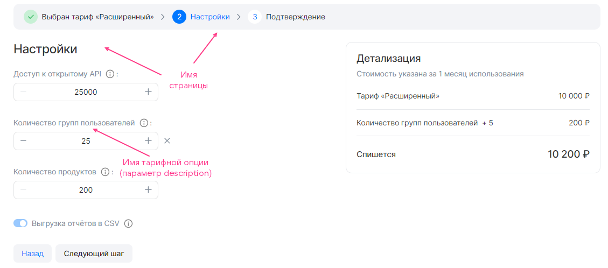

{include(/kz/_includes/_translated_by_ai_kz.md)}

`display` секциясы [сервисті конфигурациялау JSON-файлында](../../../instructions/manage-saas-apps/saas-add#service_config) [тарифтік жоспарды конфигурациялау шеберінің](/kz/tools-for-using-services/vendor-account/manage-apps/concepts/about#xaas_wizard) сипаттамасын береді. Секцияның құрылымы мынадай:

```json
"display": {
  "pages": [
    {
      <БЕТ_ПАРАМЕТРЛЕРІ>,
      "groups": [
        {
          <ТОП_ПАРАМЕТРЛЕРІ>,
          "parameters": [
            {
              <ОПЦИЯ_ПАРАМЕТРЛЕРІ>
            },
            ...
          ]
        }
        ...
      ]
    },
  ...
  ]
}
```

Мұнда:

* `pages` — тарифтік жоспарды конфигурациялау шеберінің беттерін сипаттайтын секция. Бос болуы мүмкін.
* `<БЕТ_ПАРАМЕТРЛЕРІ>` — бір беттің параметрлері.
* `groups` — бір бет аясындағы тарифтік опциялар топтарын сипаттайтын секция.
* `<ТОП_ПАРАМЕТРЛЕРІ>` — тарифтік опциялар тобының параметрлері.
* `parameters` — бір топ аясындағы тарифтік опцияларды сипаттайтын секция.

   {note:warn}

   Бір тарифтік опция тек бір топта көрсетілуі мүмкін.

   {/note}
* `<ОПЦИЯ_ПАРАМЕТРЛЕРІ>` — тарифтік опциялардың параметрлері.

`display` секциясында тарифтік жоспарды конфигурациялау шеберінің бірінші және соңғы беттерінен басқа барлық беттері сипатталады. Беттердің максималды саны — 5.

Беттердің, топтардың және топтардағы тарифтік опциялардың параметрлері бірдей және кестеде келтірілген.

[cols="2,5,4,2", options="header"]
|===
|Атауы
|Сипаттамасы
|Форматы
|Міндетті

|`name`
|
JSON-файлындағы беттің, топтың немесе тарифтік опцияның атауы.

{note:warn}

Дүкеннің интерфейсінде тарифтік опциялар [schemas секциясындағы](../schemas-section) осы опциялардың `description` параметрінде берілген атаулармен көрсетіледі.

{/note}
|
string.

Беттің атауы — 32 таңбаға дейін.

Топтың атауы — 255 таңбаға дейін
| 

|`index`
|
Беттің, беттегі топтың немесе топтағы тарифтік опцияның реттік нөмірі
|
integer
| 
|===

{cut(display секциясының мысалы)}

```json
"display": {
  "pages": [
    {
      "name": "Баптаулар", // Бет атауы
      "index": 0,
      "groups": [
        {
          "name": "", // Топ атауы
          "index": 0,
          "parameters": [
            {
              "name": "api_requests_daily_limit", // JSON-файлындағы тарифтік опция атауы
              "index": 0,
            },
            {
              "name": "groups",
              "index": 1,
            },
            {
              "name": "products",
              "index": 2,
            },
            {
              "name": "reports",
              "index": 3
            }
          ]
        }
      ]
    }
  ]
}
```

`display` секциясының бұл мазмұнына суретте келтірілген тарифтік жоспарды конфигурациялау шебері сәйкес келеді:



{/cut}

Әдепкі бойынша тарифтік жоспарды конфигурациялау шеберінде тарифтік опциялардың барлық `groups` топтары көрсетіледі және бапталады. Топ белгілі бір шарттар орындалғанда ғана көрсетілсін дегенде, [when конструкциясын](/kz/tools-for-using-services/vendor-account/manage-apps/ibservice_add/ibservice_configure/ib_display#IBdisplay_when) пайдаланыңыз.

{note:warn}

Брокер `when` конструкцияларында берілген шарттарды ескере отырып, сервистің инстансын жасауды қолдауы тиіс.

{/note}

JSON форматындағы `when` құрылымы:

```json
{
  "when": {
    "in": { // Немесе "not_in"
      "key": {
        "param": "<ОПЦИЯ_АТАУЫ>" // Немесе "const": "<МӘН>"
      },
      "values": [
        {
          "const": "<МӘН>"
        },
        {
          "param": "<ОПЦИЯ_АТАУЫ>"
        },
      ...
      ]
    }
  },
  "parameters": [
  ...
  ]
}
```

Мұнда:

* `<ОПЦИЯ_АТАУЫ>` — сервисті конфигурациялау JSON-файлындағы тарифтік опция атауы.
* `<МӘН>` — константаның мәні.

[pages секциясындағы when конструкциясы](/kz/tools-for-using-services/vendor-account/manage-apps/ibservice_add/ibservice_configure/ib_display#IBdisplay_when_in_pages) image-based қосымшалардағыдай қолданылады.

{cut(pages секциясында when конструкциясын қолдану мысалы)}

```json
{
  "pages": [
    {
      "name": "Бекап баптаулары", // Бет атауы
      "groups": [
        {
          "name": "High-frequency бекап", // Тарифтік опциялар тобының атауы
          "parameters": [
            {
              "name": "frequency_per_day" // JSON-файлындағы тарифтік опция атауы
            }
          ],
          "when": {
            "in": {
              "key": {
                "param": "backup_method" // JSON-файлындағы тарифтік опция атауы
              },
              "values": [
                {
                  "const": "high-frequency"
                }
              ]
            }
          }
        }
      ]
    }
  ]
}
```

Бұл мысалда бекап жасау жиілігі бапталады. Егер `backup_method` тарифтік опциясының мәні `high-frequency` тең болса, тарифтік жоспарды конфигурациялау шеберінде `frequency_per_day` тарифтік опциясы бар `High-frequency бекап` тобы көрсетіледі.

`backup_method` тарифтік опциясы:

* Басқа топтардағы `when` конструкциясында қолданылуы мүмкін.
* Басқа топтағы `parameters` ішінде берілуге тиіс.

`frequency_per_day` тарифтік опциясы басқа топтарда қолданыла алмайды:

* `when` конструкциясында — себебі тәуелділік иерархиясының бір ғана деңгейі қолдау көрсетеді.
* `parameters` ішінде — себебі бір тарифтік опция тек бір топта көрсетілуі мүмкін.

{/cut}