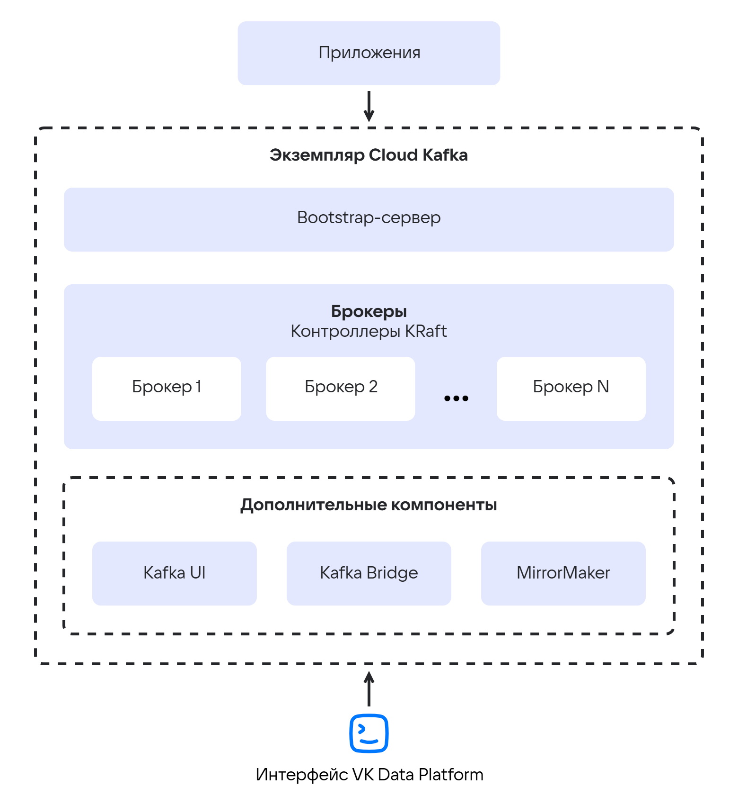

# {heading(Архитектура сервиса)[id=kafka_architecture]}

{ifdef(public)}

{include(/ru/_includes/_dp-unavailable.md)}

{/ifdef}

Экземпляр Cloud Kafka включает кластер Apache Kafka и средства подключения к нему.

## {heading(Компоненты экземпляра)[id=kafka-architecture-components]}

Экземпляр состоит из следующих компонентов:

- {linkto(../entities#kafka_entities_broker)[text=Брокеры]}. Хранят данные и обрабатывают запросы приложений.
- Контроллеры KRaft. Управляют состоянием кластера: сведениями о брокерах, {linkto(../entities#kafka_entities_topic)[text=топиках]}, {linkto(../entities#kafka_entities_partition)[text=партициях]} и назначении {linkto(../entities#kafka_entities_replica)[text=ведущих реплик]}. Контроллеры работают на брокерах кластера.
- Bootstrap-сервер. Точка начального подключения к кластеру: приложение получает отсюда адреса брокеров, а дальше работает с ними напрямую. {linkto(../../instructions/connections/connect-app#kafka_connect-app)[text=Подключение из кода приложения]} настраивается отдельно.
- Kafka UI. Предоставляет графический интерфейс для работы с объектами Apache Kafka. Дополнительный компонент.
- {linkto(../../instructions/connections/kafka-bridge#kafka_connect-bridge)[text=Kafka Bridge]}. Предоставляет REST API для отправки и чтения сообщений по HTTP. Дополнительный компонент.
{ifndef(public)}
- MirrorMaker. Реплицирует данные из внешних кластеров Apache Kafka в экземпляр Cloud Kafka. Параметры репликации приведены в инструкции по {linkto(../../instructions/replication#kafka_replication)[text=репликации]}. Дополнительный компонент.
{/ifndef}

Kafka UI и Kafka Bridge можно включить при создании экземпляра или при горизонтальном масштабировании.{ifndef(public)} MirrorMaker включается отдельно, при настройке репликации.{/ifndef} Брокеры, контроллеры и bootstrap-сервер входят в экземпляр всегда.

{caption(Рисунок {counter(pic)[id=numb_kafka_architecture_schema]} — Схема компонентов экземпляра Cloud Kafka)[align=center;position=under;id=kafka_architecture_schema;number={const(numb_kafka_architecture_schema)}]}

{params[align=center; width=65%; noBorder=true]}

{/caption}

{ifndef(public)}
## {heading(Репликация между кластерами)[id=kafka-architecture-replication]}

Для переноса данных из внешнего кластера Kafka в Cloud Kafka используется компонент MirrorMaker. Он читает сообщения из внешнего кластера и записывает их в топики текущего экземпляра. Репликация односторонняя — из внешнего кластера в Cloud Kafka. MirrorMaker — отдельный компонент, а не брокер или контроллер кластера.

Компонент размещается в одной зоне доступности. Число параллельных задач репликации задается при включении: рекомендуемое значение — вдвое больше числа CPU, выделенных для MirrorMaker. При репликации сохраняется партиционирование: сообщения с одинаковым ключом попадают в ту же партицию целевого топика.

Переносить можно данные топиков, конфигурации топиков и смещения групп потребителей. Для подключения к внешнему кластеру поддерживаются протоколы `SASL_PLAINTEXT` и `SASL_SSL`, механизмы SASL `PLAIN`, `SCRAM-SHA-256` и `SCRAM-SHA-512`.

Репликация между кластерами не заменяет внутрикластерную репликацию: она нужна для переноса данных между разными кластерами, а не для отказоустойчивости внутри экземпляра. Параметры подключения приведены в инструкции по {linkto(../../instructions/replication#kafka_replication)[text=репликации]}.
{/ifndef}

## {heading(Факторы выбора конфигурации)[id=kafka-architecture-configuration]}

Число брокеров, ресурсы узлов и настройки топиков зависят от трех факторов:

- Нагрузка. Определяет количество и размер сообщений, скорость их публикации и чтения, пиковые значения и число потребителей. Требования к вычислительным ресурсам и сети определяет пиковая нагрузка, а не средняя.
- Объем данных и срок хранения. Определяют необходимое дисковое пространство. {linkto(../../instructions/topics#kafka_topics_retention)[text=Срок хранения]} должен позволять потребителям восстановиться после перерыва и обработать накопленные сообщения. Более длительное хранение при том же потоке сообщений требует больше места на дисках.
- Требования к доступности и защите сообщений от потери. Определяют число брокеров, фактор репликации и настройки подтверждения записи. Выбрать эти параметры помогут меры {linkto(../availability#kafka-availability-durability)[text=защиты от потери сообщений]} и {linkto(../availability#kafka-availability-deployment)[text=защиты от отказов]}.
