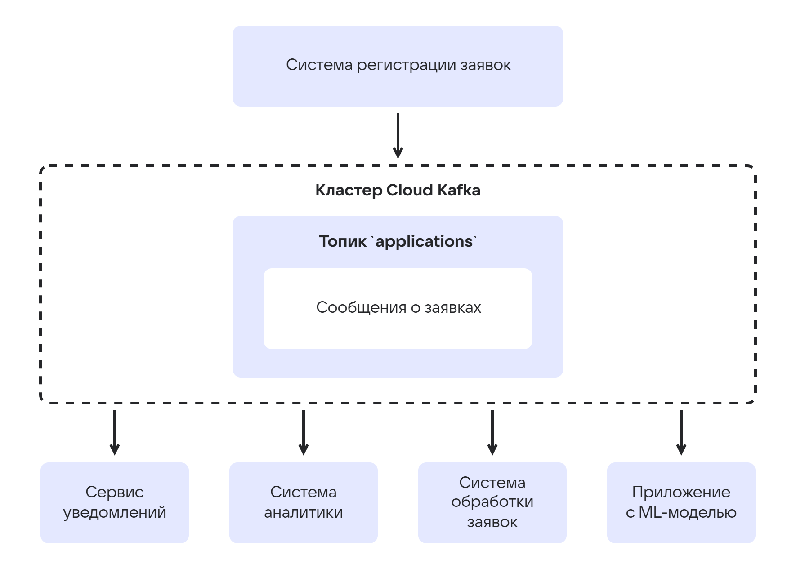
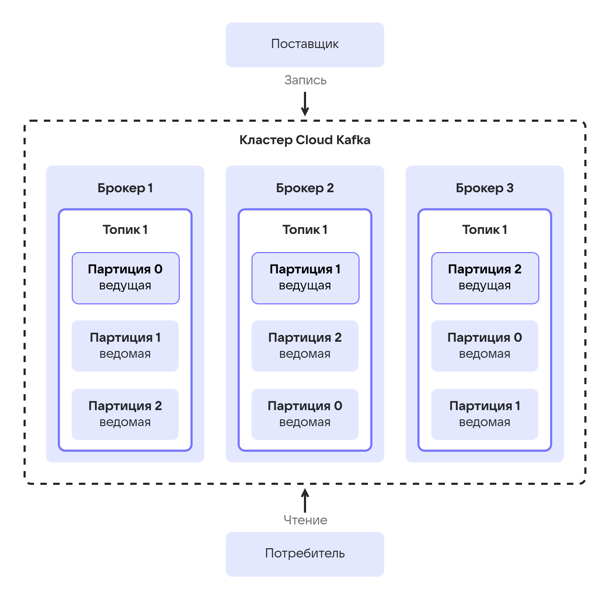

# {heading(Принцип работы сервиса)[id=kafka_entities]}

{ifdef(public)}

{include(/ru/_includes/_dp-unavailable.md)}

{/ifdef}

Cloud Kafka принимает данные от одного приложения и хранит их по заданным правилам. Другое приложение читает их по мере необходимости. Поставщику не нужно знать получателей, а получателю — читать сообщения сразу после публикации.

## {heading(Поставщики и потребители)[id=kafka-entities-clients]}

*Поставщик* (producer) — приложение, которое публикует сообщения в Cloud Kafka. *Потребитель* (consumer) — приложение, которое эти сообщения читает и обрабатывает.

Одно приложение может выполнять обе функции: читать сообщения в качестве потребителя, а затем публиковать обработанный результат как поставщик.

На схеме ниже показано направление потока сообщений на примере системы регистрации заявок.

{caption(Рисунок {counter(pic)[id=numb_kafka_entities_message_flow]} — Передача сообщений от поставщика к потребителям через Cloud Kafka)[align=center;position=under;id=kafka_entities_message_flow;number={const(numb_kafka_entities_message_flow)}]}

{params[align=center; width=70%; noBorder=true]}

{/caption}

Описание схемы:

1. Система регистрации заявок — поставщик — публикует сообщение в топик `applications`.
1. Сообщение сохраняется в {linkto(#kafka_entities_topic)[text=топике]} внутри кластера Cloud Kafka.
1. Четыре приложения — потребители — независимо друг от друга запрашивают сообщения из топика: сервис уведомлений, система аналитики, система обработки заявок и приложение с ML-моделью.
1. Кластер возвращает доступные сообщения, и каждое приложение обрабатывает их по своей логике. Сервис уведомлений отправляет подтверждение заявителю, система аналитики обновляет показатели, система обработки заявок обновляет статус заявки, а приложение с ML-моделью строит прогноз по заявкам.

Чтение не удаляет сообщения: пока они хранятся в топике, их можно прочитать повторно. Если потребитель не работает по техническим причинам, поставщики могут продолжать отправлять сообщения в топик. После восстановления потребитель прочитает и обработает пропущенные сообщения, если они еще хранятся в топике согласно {linkto(../../instructions/topics#kafka_topics_retention)[text=правилам хранения]}.

## {heading(Брокеры, топики и партиции)[id=kafka-entities-data]}

Брокеры принимают запросы приложений и хранят сообщения, топики разделяют потоки данных по назначению, а партиции делят данные топика на части.

### {heading(Брокер)[id=kafka_entities_broker]}

*Брокер* (broker) — серверный процесс Cloud Kafka, который принимает сообщения от поставщиков, хранит данные и возвращает сообщения по запросам потребителей.

Брокеры объединяются в {linkto(../architecture#kafka_architecture)[text=кластер]} — группу брокеров, которые совместно хранят данные и обрабатывают запросы. Каждый брокер работает на отдельном узле, а узлы входят в кластер. Кластер вместе со средствами подключения образует экземпляр Cloud Kafka. Один брокер может хранить данные нескольких топиков, а данные одного топика могут располагаться на разных брокерах.

### {heading(Топик)[id=kafka_entities_topic]}

*Топик* (topic) — именованный поток сообщений, объединенных по назначению. Например, топик `applications` может содержать события о регистрации и обработке заявок в информационной системе организации.

Поставщик указывает топик при отправке сообщения. Потребитель подписывается на нужные топики и запрашивает данные. В один топик могут публиковать сообщения несколько поставщиков, а читать его могут разные приложения.

Данные топика распределены по партициям, а копии каждой партиции хранятся на разных брокерах.

### {heading(Партиция)[id=kafka_entities_partition]}

*Партиция* (partition) — часть топика, в которую сообщения записываются в порядке поступления. Каждый топик содержит одну или несколько партиций.

При публикации каждое сообщение попадает в одну партицию топика.

Партиции одного топика размещаются на разных брокерах, поэтому запросы к топику обрабатывают несколько брокеров и нагрузка распределяется между ними.

### {heading(Реплика)[id=kafka_entities_replica]}

*Реплика* (replica) — копия данных партиции. Реплики одной партиции размещаются на разных брокерах, чтобы отказ одного брокера не делал недоступными все копии.

У каждой партиции есть одна *ведущая реплика* (leader), которая принимает новые сообщения от поставщиков. Остальные реплики — ведомые: они получают данные от ведущей. Роль относится к партиции, а не к брокеру целиком. Один брокер может хранить ведущую реплику одной партиции и ведомую реплику другой.

*Фактор репликации* (replication factor) — общее количество реплик каждой партиции, включая ведущую. Например, значение `2` означает две копии: одну ведущую и одну ведомую на другом брокере. Для размещения нужны как минимум два брокера.

Реплики защищают данные от потери и повышают доступность, но не делят поток сообщений на новые части. Дополнительная реплика не становится новой партицией и не увеличивает число потребителей, которые могут одновременно читать топик в одной группе потребителей.

### {heading(Связи между сущностями)[id=kafka-entities-layout]}

На схеме показан кластер из трех брокеров и топик, разделенный на три партиции. На каждом брокере хранятся по три реплики — по одной от каждой партиции.

{caption(Рисунок {counter(pic)[id=numb_kafka_entities_data_layout]} — Связь топика, партиций и брокеров Cloud Kafka)[align=center;position=under;id=kafka_entities_data_layout;number={const(numb_kafka_entities_data_layout)}]}

{params[align=center; width=70%; noBorder=true]}

{/caption}

Фактор репликации в этом примере равен трем, поэтому каждая партиция хранится на всех брокерах. У каждой партиции одна реплика ведущая, две — ведомые, а ведущие распределены по разным брокерам. Если брокер с ведущей репликой недоступен, кластер может назначить ведущей одну из ведомых реплик.

Количество брокеров задается {linkto(../architecture#kafka-architecture-configuration)[text=конфигурацией экземпляра]}, а фактор репликации — настройками топика. Поведение кластера при отказах описано в статье {linkto(../availability#kafka-availability)[text=Высокая доступность]}.

## {heading(Порядок сообщений и ключ)[id=kafka-entities-order]}

Внутри партиции сообщения сохраняют порядок записи. У каждого сообщения есть *смещение* (offset) — число, которое определяет его положение в партиции. После перезапуска потребитель может продолжить чтение с сохраненной позиции, если сообщения с этой позиции еще хранятся в топике.

Единого порядка между разными партициями топика нет. Например, если в одну партицию последовательно записаны события о регистрации заявки и о рассмотрении заявки, потребитель прочитает их в этом порядке. Если события оказались в разных партициях, порядок их чтения относительно друг друга не определен.

Чтобы связанные события попадали в одну партицию, поставщик указывает *ключ сообщения* — например, идентификатор заявки. Если распределение идет по ключу, сообщения с одинаковым ключом направляются в одну партицию, пока не изменится число партиций или алгоритм распределения. Потребитель читает их в порядке записи.

Если поставщик не указал ключ, партицию выбирает клиентская библиотека поставщика по своему алгоритму. В таком случае связанные события могут попасть в разные партиции.

## {heading(Группы потребителей)[id=kafka-entities-groups]}

Чтобы несколько экземпляров сервиса обрабатывали поток быстрее, их объединяют в *группу потребителей* (consumer group). Внутри группы каждую партицию в каждый момент времени читает один участник, поэтому нагрузка распределяется между экземплярами. Один потребитель может читать несколько партиций.

У каждой группы свои позиции чтения в партициях. Разные группы читают тот же поток независимо. Например, временная недоступность системы аналитики не останавливает чтение сообщений сервисом уведомлений, если они используют разные группы.
